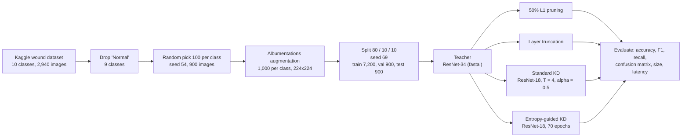
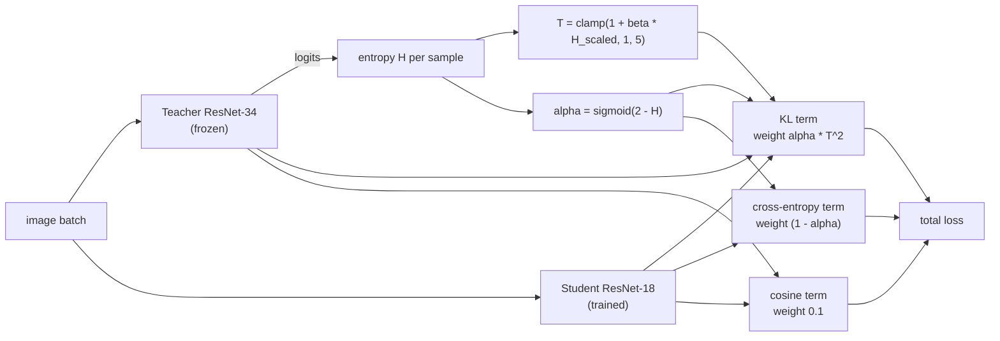
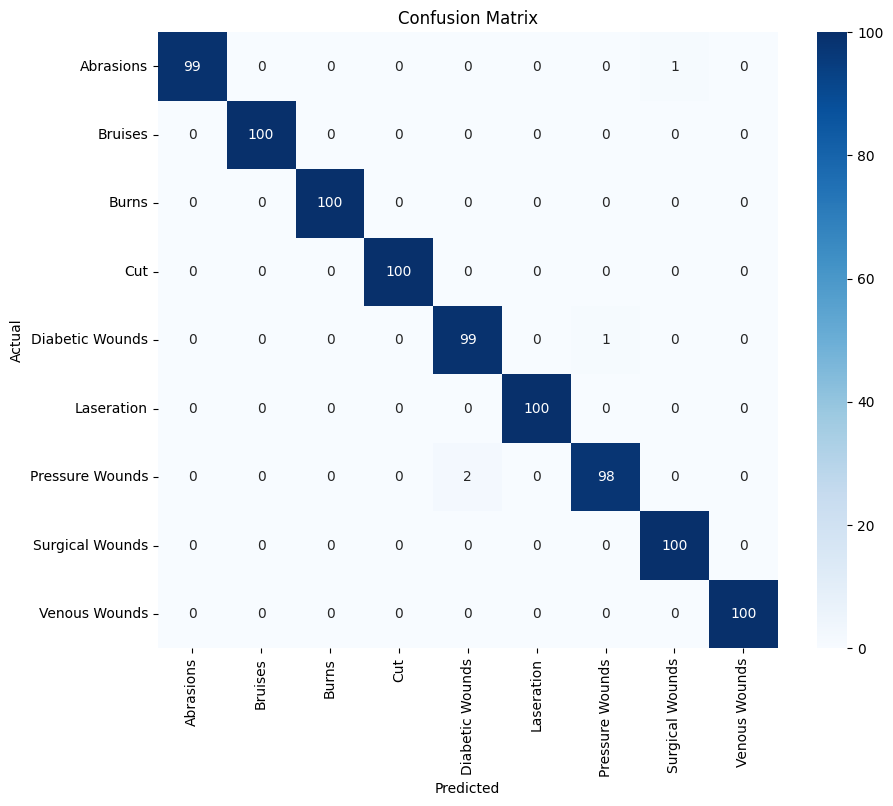
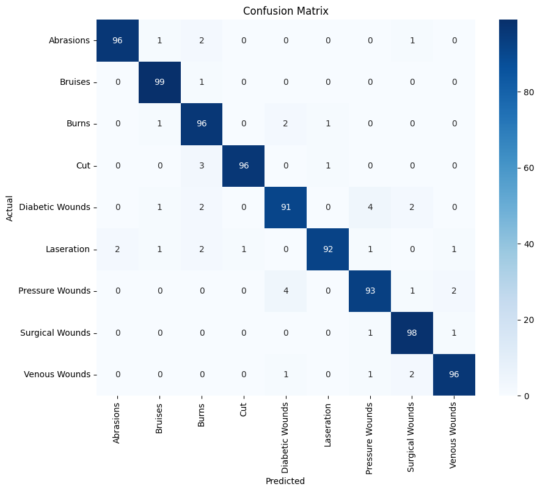

# Entropy-Guided Knowledge Distillation for Wound Image Classification


Code behind the ICCI 2025 paper **"Knowledge Distillation Using Entropy-Guided Dynamic Parameter Transfer for Wound Image Classification"** (IEEE, Paper ID 694422), written with five co-authors. This repository contains the first author's (Atilak Modetad) experiment notebook and the trained models.
Paper: [IEEE Xplore](https://ieeexplore.ieee.org/document/10987261) · [ResearchGate](https://www.researchgate.net/publication/391693610_Knowledge_Distillation_Using_Entropy-Guided_Dynamic_Parameter_Transfer_for_Wound_Image_Classification). Produced in the IPST/PMU-B RAC (Robotics, AI and Coding) program.

**In one line:** a small ResNet-18 learns from a ResNet-34 teacher, and the teacher's own uncertainty (prediction entropy) decides, sample by sample, how soft the teacher's answers are and how much to trust them.

| | |
|---|---|
| Task | 9-class wound image classification (Kaggle wound dataset) |
| Teacher to student | ResNet-34 (21.8 M parameters, 83.8 MB) to ResNet-18 (11.2 M parameters, 42.7 MB, 49% smaller) |
| Best student, as logged | **95.22%** test accuracy, against 90.89% for fixed-parameter KD (+4.33 points) |
| Read first | The split was made *after* augmentation, so every accuracy here is optimistic. See [Honest notes](#honest-notes) |

## Pipeline



## Method: entropy-guided adaptive scaling (EGAS)

For every sample the teacher's softmax entropy `H` sets two things:

- **EGATS**, the temperature: `T = clamp(1 + β·H_scaled, 1, 5)` with `β = 2`. Uncertain samples get a softer teacher.
- **EGAAS**, the loss balance: `α = σ(2 − H)`. A confident teacher is trusted more (large KL weight), an uncertain one less (large cross-entropy weight).
- A small cosine term (weight 0.1) keeps the student's outputs aligned with the teacher's.



The loss class is in [`src/egas_loss.py`](src/egas_loss.py), extracted verbatim from the notebook.

## Results as logged

Nine classes, 900 test images. Sizes, timings and accuracies follow the paper's Tables VII and VIII; the notebook logs the same accuracies and timings within noise (for example 7.9 ms for the teacher).

| Model | File (MB) | Time per image | Test accuracy |
|---|---|---|---|
| ResNet-34 teacher | 83.78 | 7.6 ms | 99.56% |
| Teacher, 50% L1 unstructured pruning | 83.79 | 9.6 ms | 99.33% |
| ResNet-18, standard KD | 42.73 | 4.2 ms | 90.89% |
| Layer truncation | 81.35 | 16.0 ms | 11.11% (collapsed, see notes) |
| **ResNet-18, entropy-guided KD** | **42.73** | 2.7 ms | **95.22%** |

<table>
<tr>
<td align="center"><b>Teacher (99.56%)</b><br></td>
<td align="center"><b>Entropy-guided student (95.22%)</b><br></td>
</tr>
</table>

More figures are in [`docs/figures/`](docs/figures): confusion matrices for every model and the raw class distribution.

## Honest notes

Read these before citing any number.

1. **Augmentation happens before the split.** Cell 17 augments 100 source images per class into 1,000, and cell 21 then splits that pool 80/10/10. Variants of the same source image can land in train and test, so the accuracies are very likely inflated. The fix is to split the 900 originals first and augment only the training part. This is the planned re-evaluation.
2. **Gain over standard KD is 4.33 points** (95.22 − 90.89). The paper's conclusion says +4.66%; its own Table VIII gives 4.33.
3. **The latency gap is not an architecture effect.** Both students are the same ResNet-18 with the same 42.73 MB file, yet the single-image timings are 4.2 ms and 2.7 ms. Those timings are noisy (no warm-up, one image) and do not support the paper's "36% faster" statement. A proper benchmark needs warm-up, many runs and a fixed batch size.
4. **Layer truncation collapsed.** Training accuracy reached 99.9% but every test image was predicted as class 0 (11.11% = chance). That points to a pipeline problem (for example a preprocessing mismatch) as much as to "too much compression".
5. **Pruning gives no speed-up.** Unstructured L1 pruning zeroes weights but keeps dense tensors, so file size is unchanged and latency did not improve.

### Implementation notes (code versus the paper's text)

- The KL target in the entropy-guided loss is `teacher_probs / T`, which is not a probability distribution; standard KD uses `softmax(teacher_logits / T)`, as the baseline cell does.
- The "contrastive" term is a cosine embedding loss on the **logits**, not on intermediate features as the paper describes.
- `H_scaled` is a min-max over the current batch, so the temperature depends on batch composition.
- The baseline-KD cell sets `epochs = 10` while Table VI lists 20, so the saved baseline may come from another run.
- The teacher is ImageNet-pretrained (fastai's `vision_learner` default) and fine-tuned, while the ResNet-18 students are created with `pretrained=False`, so they are trained from scratch. The comparison is a pretrained teacher against students that start from random weights.

## Repository layout

```
notebooks/entropy_guided_kd.ipynb   full experiment (68 cells, outputs kept)
src/egas_loss.py                    entropy-guided KD loss, verbatim from the notebook
models/                             how to download the 5 trained models (release assets) and their checksums
data/                               data description and a manifest of the 900-image subset
scripts/rebuild_subset.py           rebuilds the 900-image subset from the Kaggle archive
docs/figures/                       confusion matrices and class distribution
requirements.txt                    libraries the notebook imports
```

Notebook map: data preparation (cells 0-27), teacher (28-38), pruning (39-41), standard KD (42-44), layer truncation (45-47), speed check (48-54), entropy-guided KD (55-58), discarded variants (59-63), K-fold (64-67, commented out; in the saved Drive copy only folds 1 and 2 hold images, and fold 2 is incomplete).

## Run

[](https://colab.research.google.com/github/Taiga0727/entropy-guided-kd-wound-classification/blob/main/notebooks/entropy_guided_kd.ipynb)

1. Open `notebooks/entropy_guided_kd.ipynb` in Google Colab with a GPU runtime.
2. Put the Kaggle archive at `MyDrive/RAC/archive.zip` (see [`data/README.md`](data/README.md)); the notebook unzips it and writes its working folders under `MyDrive/RAC/`.
3. Run the cells in order. Paths are Colab paths (`/content/drive/MyDrive/RAC/...`) and need editing elsewhere.

To use the trained models without retraining, download them from the [`v1.0` release](https://github.com/Taiga0727/entropy-guided-kd-wound-classification/releases/tag/v1.0) (instructions and checksums in [`models/README.md`](models/README.md)). The `.pkl` files are fastai/PyTorch pickles: load them only from a source you trust.

## Status

Research code, not a packaged library. The dataset is not redistributed, and the paper PDF is not hosted here (publisher copyright); use the links at the top. License: [MIT](LICENSE) for the code and write-up; the trained weights come with extra conditions, see [`models/README.md`](models/README.md).
