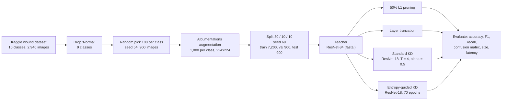
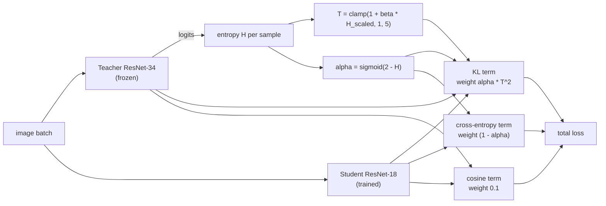

# Entropy-Guided Knowledge Distillation for Wound Image Classification

[](LICENSE)
[](https://ieeexplore.ieee.org/document/10987261)


[](https://colab.research.google.com/github/Taiga0727/entropy-guided-kd-wound-classification/blob/main/notebooks/entropy_guided_kd.ipynb)

A ResNet-18 learns from a ResNet-34 teacher whose own uncertainty (prediction entropy) decides, per sample, how soft the teacher's targets are and how much weight they get.

Code and trained models for the ICCI 2025 paper **"Knowledge Distillation Using Entropy-Guided Dynamic Parameter Transfer for Wound Image Classification"** (IEEE, Paper ID 694422; six authors, I am the first), made in the IPST/PMU-B RAC (Robotics, AI and Coding) program. Paper: [IEEE Xplore](https://ieeexplore.ieee.org/document/10987261) · [ResearchGate](https://www.researchgate.net/publication/391693610_Knowledge_Distillation_Using_Entropy-Guided_Dynamic_Parameter_Transfer_for_Wound_Image_Classification).

| | |
|---|---|
| Task | 9-class wound image classification ([Kaggle dataset](data/README.md)) |
| Teacher to student | ResNet-34 (21.8 M parameters, 83.8 MB) to ResNet-18 (11.2 M, 42.7 MB, 49% smaller) |
| Best student, as logged | **95.22%** test accuracy against 90.89% for fixed-parameter KD (+4.33 points) |
| Read first | The split was made *after* augmentation, so every accuracy is optimistic ([Limitations](#limitations)) |

[Pipeline](#pipeline) · [Method](#method) · [Results](#results) · [Limitations](#limitations) · [Run](#run) · [Cite](#cite)

## Pipeline



## Method

The teacher's softmax entropy `H` sets two values per sample (entropy-guided adaptive scaling, EGAS):

- **EGATS, temperature:** `T = clamp(1 + β·H_scaled, 1, 5)`, `β = 2`. Uncertain samples get a softer teacher.
- **EGAAS, loss balance:** `α = σ(2 − H)`. A confident teacher gets a large KL weight, an uncertain one a large cross-entropy weight.
- **Cosine term:** weight 0.1, keeps the student's outputs aligned with the teacher's.



The loss is [`src/egas_loss.py`](src/egas_loss.py), extracted verbatim from the notebook. Its core, simplified:

```python
entropy = -torch.sum(teacher_probs * torch.log(teacher_probs + 1e-9), dim=1)
entropy_scaled = (entropy - entropy.min()) / (entropy.max() - entropy.min())  # per-batch min-max
T = torch.clamp(1.0 + self.beta * entropy_scaled, min=1.0, max=5.0)           # EGATS
adaptive_alpha = torch.sigmoid(2 - entropy)                                    # EGAAS
```

## Results

Nine classes, 900 test images. Values follow the paper's Tables VII and VIII; the notebook logs the same accuracies and timings within noise (for example 7.9 ms for the teacher).

| Model | File (MB) | Time per image | Test accuracy |
|---|---|---|---|
| ResNet-34 teacher | 83.78 | 7.6 ms | 99.56% |
| Teacher, 50% L1 unstructured pruning | 83.79 | 9.6 ms | 99.33% |
| ResNet-18, standard KD | 42.73 | 4.2 ms | 90.89% |
| Layer truncation | 81.35 | 16.0 ms | 11.11% (collapsed, see Limitations) |
| **ResNet-18, entropy-guided KD** | **42.73** | 2.7 ms | **95.22%** |

<table>
<tr>
<td align="center"><b>Teacher (99.56%)</b><br></td>
<td align="center"><b>Entropy-guided student (95.22%)</b><br></td>
</tr>
</table>

Confusion matrices for every model and the raw class distribution are in [`docs/figures/`](docs/figures).

## Limitations

Read these before citing any number.

1. **Augmentation before the split.** Cell 17 expands 100 source images per class to 1,000 and cell 21 then splits that pool 80/10/10, so variants of one image can land in both train and test and the accuracies are very likely inflated. Fix: split the 900 originals first and augment only the training part (planned).
2. **The gain over standard KD is 4.33 points** (95.22 − 90.89). The paper's conclusion says +4.66%; its own Table VIII gives 4.33.
3. **The latency gap is not an architecture effect.** Both students are the same ResNet-18 with the same 42.73 MB file, yet time at 4.2 and 2.7 ms. Single-image timings without warm-up are noise and do not support the paper's "36% faster". Fix: warm-up, many runs, fixed batch size.
4. **Layer truncation collapsed.** 99.9% training accuracy, but every test image was predicted as class 0 (11.11% = chance); that points to a pipeline problem (for example a preprocessing mismatch) as much as to over-compression.
5. **Pruning gives no speed-up.** Unstructured L1 pruning keeps dense tensors, so file size and latency do not improve.

**Code versus the paper's text**

- The KL target is `teacher_probs / T`, which is not a probability distribution; the baseline cell uses the standard `softmax(teacher_logits / T)`.
- The "contrastive" term is a cosine embedding loss on the **logits**, not on intermediate features as the paper describes.
- `H_scaled` is a per-batch min-max, so the temperature depends on batch composition.
- The baseline-KD cell sets `epochs = 10` while Table VI lists 20, so the saved baseline may come from another run.
- The teacher is ImageNet-pretrained (fastai's `vision_learner` default) and fine-tuned; the ResNet-18 students use `pretrained=False` and train from scratch.

## Run

1. Open `notebooks/entropy_guided_kd.ipynb` in Google Colab with a GPU runtime (badge above).
2. Put the Kaggle archive at `MyDrive/RAC/archive.zip` ([`data/README.md`](data/README.md), which also explains how `scripts/rebuild_subset.py` restores the exact 900-image subset); the notebook unzips it and writes its folders under `MyDrive/RAC/`.
3. Run the cells in order. Paths are Colab paths (`/content/drive/MyDrive/RAC/...`). Libraries: `requirements.txt`.

<details>
<summary>Notebook map (68 cells)</summary>

Data preparation (cells 0-27), teacher (28-38), pruning (39-41), standard KD (42-44), layer truncation (45-47), speed check (48-54), entropy-guided KD (55-58), discarded variants (59-63), K-fold (64-67, commented out; in the saved Drive copy only folds 1 and 2 hold images, and fold 2 is incomplete).

</details>

To skip training, download the five models from the [`v1.0` release](https://github.com/Taiga0727/entropy-guided-kd-wound-classification/releases/tag/v1.0). Loading code and SHA-256 checksums are in [`models/README.md`](models/README.md); the `.pkl` teacher files are pickled fastai learners, so load them only from a source you trust.

## Cite

GitHub's "Cite this repository" button reads [`CITATION.cff`](CITATION.cff). BibTeX for the paper:

```bibtex
@inproceedings{modetad2025egas,
  title     = {Knowledge Distillation Using Entropy-Guided Dynamic Parameter Transfer for Wound Image Classification},
  author    = {Modetad, Atilak and Chansirisri, Natamon and Charoensuk, Phollaphat and Pornsukjantra, Preravitch and Kaewprachum, Phanomyong and Chungnoy, Kritanat},
  booktitle = {International Conference on Cybernetics and Innovations (ICCI)},
  year      = {2025},
  publisher = {IEEE},
  url       = {https://ieeexplore.ieee.org/document/10987261}
}
```

Research code, not a packaged library. The dataset is not redistributed and the paper PDF is not hosted (publisher copyright). [MIT](LICENSE) for the code and write-up; the trained weights carry extra conditions, see [`models/README.md`](models/README.md).
